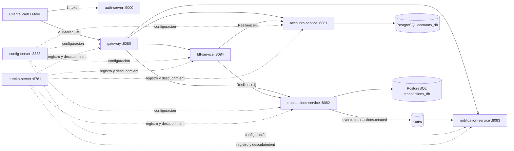

# Banco XYZ – Microservicios seguros y resilientes en la nube

Proyecto de la **Sumativa 3 (Semana 8) – Desarrollo Backend III (PBY2203)**.
Moderniza el sistema legacy del Banco XYZ (datos de `bank_legacy_data`) como una arquitectura de microservicios
con **Spring Cloud**, protegida con **OAuth 2.0 + JWT**, tolerante a fallos con **Resilience4j**, orientada a eventos con
**Apache Kafka** y completamente **dockerizada** con **Docker Compose**.

## Objetivo

| Requerimiento de la sumativa | Dónde se implementa |
|---|---|
| 1. Implementar OAuth 2.0 | `auth-server` (Spring Authorization Server) + todos los demás como *Resource Servers* |
| 2. Dockerizar los microservicios | Un `Dockerfile` multi-etapa dentro de cada módulo |
| 3. Configurar `docker-compose.yaml` | `docker-compose.yaml` en la raíz (10 contenedores) |
| IL6 – Spring Cloud (Config, Eureka, Gateway) | `config-server`, `eureka-server`, `gateway` |
| IL7 – Tolerancia a fallos (Resilience4j) | `bff-service`: Circuit Breaker + Retry + Bulkhead + Fallback |
| IL8 – Mensajería asíncrona (Kafka) | `transactions-service` (productor) → `notification-service` (consumidor) |
| IL9 – Seguridad en entornos distribuidos | Scopes por canal, validación JWT en Gateway **y** en cada servicio |

## Arquitectura



| Módulo | Puerto | Rol |
|---|---|---|
| `config-server` | 8888 | Configuración centralizada (carpeta `config-repo`) |
| `eureka-server` | 8761 | Service Discovery |
| `auth-server` | 9000 | Servidor de autorización OAuth 2.0 / OIDC, emite JWT |
| `gateway` | 8080 | Punto de entrada único; valida JWT y enruta |
| `bff-service` | 8084 | *Backend for Frontend*: `/web/**` (respuesta completa) y `/mobile/**` (respuesta liviana) |
| `accounts-service` | 8081 | Cuentas (migradas desde `intereses.csv`) |
| `transactions-service` | 8082 | Movimientos (migrados desde `cuentas_anuales.csv`); publica eventos |
| `notification-service` | 8083 | Consume eventos de Kafka y genera notificaciones |
| `postgres` / `kafka` | 5432 / 9092 | Base de datos y broker de mensajes |

## Tecnologías

Java 17 · Spring Boot 3.3.5 · Spring Cloud 2023.0.3 · Spring Authorization Server · Spring Security (Resource Server) ·
Resilience4j · Spring Kafka (Kafka 3.8, modo KRaft) · Spring Data JPA · PostgreSQL 16 · Docker / Docker Compose · Maven multi-módulo

## Estructura del código

```
banco-xyz-cloud/
├── pom.xml                      # POM padre (versiones de Boot y Cloud)
├── docker-compose.yaml          # Orquestación completa
├── docker/postgres/init.sql     # Crea accounts_db y transactions_db
├── config-server/               # + src/main/resources/config-repo/*.yml  (configuración de todos los servicios)
├── eureka-server/
├── auth-server/                 # AuthorizationServerConfig: clientes, usuarios, JWK
├── gateway/                     # Rutas (config-repo/gateway.yml) + SecurityConfig reactivo
├── bff-service/                 # BffController, AccountsClient / TransactionsClient (Resilience4j)
├── accounts-service/            # Entidad Cuenta + CuentaDataLoader (limpieza del CSV)
├── transactions-service/        # Movimiento + publicación de eventos Kafka
├── notification-service/        # @KafkaListener + idempotencia + Dead Letter Topic
├── scripts/                     # demo.sh / demo.ps1 (generan la evidencia de ejecución)
└── docs/PROPUESTA_TECNICA.md
```
Cada módulo contiene su propio `Dockerfile`.

## Requisitos

* Docker Desktop (o Docker Engine) con Compose v2 – **≈ 4 GB de RAM libres** para los 10 contenedores
* No se necesita Java ni Maven instalados: la compilación ocurre dentro de Docker

## Cómo ejecutar

```bash
git clone <URL-de-tu-repositorio>
cd banco-xyz-cloud
docker compose up --build -d
docker compose ps            # esperar a que todos digan "healthy" (≈ 3-5 minutos la primera vez)
```

El orden de arranque es automático (`depends_on` con *healthchecks*):
`postgres/kafka/config-server/eureka-server/auth-server → accounts/transactions/notification → bff → gateway`.

Verificar: Eureka en <http://localhost:8761> debe mostrar `GATEWAY`, `BFF-SERVICE`, `ACCOUNTS-SERVICE`,
`TRANSACTIONS-SERVICE` y `NOTIFICATION-SERVICE` registrados.

Detener: `docker compose down` (agrega `-v` para borrar también los datos de PostgreSQL).

### Ejecución en desarrollo (sin contenedores para los servicios)

```bash
docker compose up -d postgres kafka          # solo infraestructura
mvn -pl config-server spring-boot:run        # en terminales separadas, en este orden:
mvn -pl eureka-server spring-boot:run
mvn -pl auth-server spring-boot:run
mvn -pl accounts-service spring-boot:run     # ...y así con el resto
```
Los valores por defecto (`localhost`) están definidos en `config-repo` con la sintaxis `${VARIABLE:valor}`.

## Seguridad (OAuth 2.0)

Todas las llamadas requieren un **access token JWT**. Se obtiene del `auth-server`:

| Cliente | Secreto | Grant | Scopes |
|---|---|---|---|
| `web-client` | `web-secret` | client_credentials | `web`, `bank.read` |
| `mobile-client` | `mobile-secret` | client_credentials | `mobile`, `bank.read` |
| `admin-client` | `admin-secret` | client_credentials | `web`, `mobile`, `bank.read`, `bank.write` |
| `postman-client` | `postman-secret` | authorization_code (usuarios `ejecutivo`/`ejecutivo123`, `cliente`/`cliente123`) | todos |

| Endpoint (vía Gateway :8080) | Scope requerido |
|---|---|
| `GET /web/accounts/{id}/summary` | `web` |
| `GET /mobile/accounts/{id}/summary` | `mobile` |
| `GET /api/accounts`, `/api/transactions/account/{id}`, `/api/notifications` | `bank.read` |
| `POST /api/transactions` | `bank.write` |

> Las credenciales son solo para fines académicos. En producción los secretos se inyectan con un gestor de secretos
> (Vault, AWS Secrets Manager…) y no se versionan.

## Pruebas manuales

Hay scripts que ejecutan todo el recorrido: `./scripts/demo.sh` (Linux/macOS/Git Bash) o `.\scripts\demo.ps1` (PowerShell).
Paso a paso (usa `curl.exe` en PowerShell):

```bash
# 1) Sin token -> 401
curl -i http://localhost:8080/web/accounts/101/summary

# 2) Obtener token del canal web
TOKEN=$(curl -s -u web-client:web-secret -d grant_type=client_credentials -d "scope=web bank.read" \
        http://localhost:9000/oauth2/token | sed -E 's/.*"access_token":"([^"]+)".*/\1/')

# 3) Canal web (respuesta completa)  ->  200
curl -s -H "Authorization: Bearer $TOKEN" http://localhost:8080/web/accounts/101/summary

# 4) Mismo token en el canal móvil -> 403 (le falta el scope "mobile")
curl -i -H "Authorization: Bearer $TOKEN" http://localhost:8080/mobile/accounts/101/summary

# 5) Registrar una transacción (necesita admin-client / bank.write) -> publica evento en Kafka
ADMIN=$(curl -s -u admin-client:admin-secret -d grant_type=client_credentials \
        -d "scope=web mobile bank.read bank.write" http://localhost:9000/oauth2/token \
        | sed -E 's/.*"access_token":"([^"]+)".*/\1/')
curl -s -X POST http://localhost:8080/api/transactions -H "Authorization: Bearer $ADMIN" \
     -H "Content-Type: application/json" \
     -d '{"cuentaId":101,"tipo":"deposito","monto":25000,"descripcion":"Deposito de prueba"}'

# 6) Ver la notificación generada por el consumidor
docker logs bank-notification-service | grep NOTIFICACION
curl -s -H "Authorization: Bearer $ADMIN" http://localhost:8080/api/notifications
```

### Probar la resiliencia (Circuit Breaker)

```bash
docker stop bank-accounts-service                      # simulamos la caída de un servicio
for i in 1 2 3 4 5 6 7 8; do                           # el BFF responde igual, con "degraded": true
  curl -s -H "Authorization: Bearer $TOKEN" http://localhost:8080/web/accounts/101/summary; echo; done
curl -s -H "Authorization: Bearer $TOKEN" http://localhost:8084/actuator/circuitbreakers   # estado: OPEN
docker start bank-accounts-service                     # tras ~15 s pasa a HALF_OPEN y luego CLOSED
```
Las primeras llamadas tardan ≈1,5 s (3 intentos del *Retry*); cuando el circuito se abre, el *fallback* responde al instante.

## Datos y calidad (Spring Batch-like en el arranque)

Los CSV legacy se limpian al iniciar cada servicio (ver logs de `accounts-service` y `transactions-service`):

* `intereses.csv` → 1000 filas → **50 cuentas** válidas (se descartan saldos vacíos, edades fuera de 18–100, tipos `-1`/`unknown`, nombre `Unknown`; se eliminan duplicados por `cuenta_id`).
* `cuentas_anuales.csv` → 1000 filas → **686 movimientos** (se normalizan 4 formatos de fecha y `depósito`→`deposito`; se descartan montos vacíos, ≤ 0 y tipos inválidos).
* Los movimientos existen para las cuentas **101–120**; las cuentas 121–150 existen pero sin historial.

## Evidencia de ejecución sugerida

1. `docker compose ps` con todos los contenedores `healthy`
2. Panel de Eureka con los 5 servicios registrados
3. Petición sin token (401) y con token (200) · canal web vs. móvil · 403 por scope incorrecto
4. `POST /api/transactions` + log `NOTIFICACION ENVIADA` en `notification-service`
5. Prueba de resiliencia: respuesta `degraded: true` y `/actuator/circuitbreakers` en estado `OPEN`
6. Logs de arranque de cada microservicio

## Solución de problemas

| Síntoma | Causa / solución |
|---|---|
| Un servicio queda `unhealthy` al inicio | Espera 1-2 min más; los healthchecks reintentan. Revisa `docker compose logs <servicio>` |
| `401` con un token recién emitido | El token dura 30 min; si reiniciaste `auth-server` las llaves cambian: solicita un token nuevo |
| `503` desde el Gateway justo después de levantar | Eureka aún no propaga el registro (≈30 s). Reintenta |
| Falta memoria | Aumenta la RAM de Docker Desktop (Settings → Resources) a 4 GB o más |
| Puerto ocupado | Cambia el mapeo `"host:contenedor"` en `docker-compose.yaml` |
