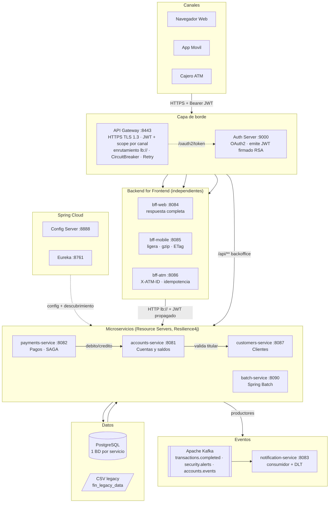
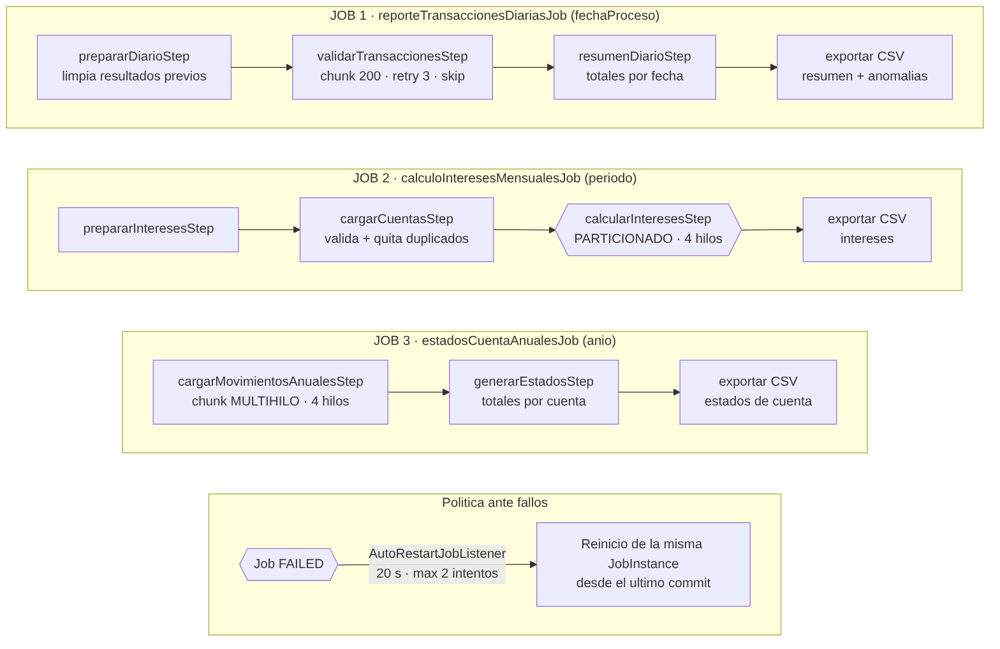

# Banco XYZ – Modernización del sistema legacy a microservicios en la nube

**Evaluación Final Transversal – Desarrollo Backend III (PBY2203) · "Desarrollo Backend Avanzado: Spring Cloud y Batch"**

El Banco XYZ opera hace más de 30 años sobre un mainframe con programas **COBOL y scripts Shell**. Este proyecto
reemplaza esa plataforma por una arquitectura de **microservicios Spring Boot / Spring Cloud**, con procesos batch en
**Spring Batch**, un **Backend for Frontend por canal** (web, móvil y cajeros), seguridad **OAuth2 + JWT + HTTPS**,
tolerancia a fallos con **Resilience4j**, eventos en tiempo real con **Apache Kafka**, monitoreo con
**Prometheus/Grafana/Zipkin** y despliegue con **Docker Compose** preparado para **AWS**.

| Documento | Contenido |
|---|---|
| [`readme.md`](readme.md) | Este archivo: visión general, arquitectura y organización del código |
| [`instrucciones.md`](instrucciones.md) | Paso a paso para ejecutar y probar cada componente |
| [`despliegue.md`](despliegue.md) | Despliegue en la nube (AWS: EC2 + Docker Compose y ECS Fargate + RDS + MSK) |
| `docs/informe_tecnico.pdf` | Informe técnico con diagramas (arquitectura, casos de uso, componentes, secuencia) |
| `docs/diagramas/` | Diagramas en PNG y su fuente Mermaid |

---

## 1. Cumplimiento de los requerimientos

### Parte 1 – Migración de procesos batch (Spring Batch) → `batch-service`

| Requerimiento | Implementación |
|---|---|
| Reescribir los procesos en Spring Batch | 3 jobs: `reporteTransaccionesDiariasJob`, `calculoInteresesMensualesJob`, `estadosCuentaAnualesJob`, sobre los CSV de [`fin_legacy_data`](https://github.com/KariVillagran/fin_legacy_data) |
| Jobs con steps de lectura, proceso y escritura | `FlatFileItemReader` → `ItemProcessor` (reglas legacy) → `JdbcBatchItemWriter` (válidos) / rechazados (`ClassifierCompositeItemWriter`) → tasklets SQL de agregación → exportación a CSV |
| Manejo de excepciones y reintentos | `faultTolerant().retry(TransientDataAccessException…)`, `retryLimit(3)`, *backoff* exponencial; `skip(FlatFileParseException)` con registro en `bt_registro_rechazado` |
| Optimizar grandes volúmenes | Chunks de 200 con escritura JDBC por lotes, **particionamiento** en 4 hilos (intereses) y **step multihilo** (estados anuales) |
| Finalización y reejecución automática | `JobRepository` en PostgreSQL, `startLimit`, reinicio desde el último *commit* y `AutoRestartJobListener` (reintenta un job FAILED tras 20 s, máx. 2 veces; no reintenta errores de calidad de datos) |
| Integridad y equivalencia con el legacy | Steps idempotentes (limpieza por clave de proceso), redondeo `HALF_UP` = `ROUNDED` de COBOL y prueba automática `EquivalenciaLegacyIntegrationTest` que compara contra los scripts Shell/awk de `batch-service/legacy-reference/` |

### Parte 2 – Backend for Frontend → `bff-web`, `bff-mobile`, `bff-atm`

| Requerimiento | Implementación |
|---|---|
| BFF Web (datos completos) | `GET /web/customers/{id}/dashboard` agrega perfil + todas las cuentas + movimientos; `GET /web/accounts/{id}/summary`; `POST /web/transfers` |
| BFF Móvil (respuestas ligeras) | Solo campos esenciales, máx. 5 movimientos pedidos al origen, nulos omitidos, **gzip**, **ETag/304** y `Cache-Control` |
| BFF Cajeros (seguro y eficiente) | `GET /atm/accounts/{id}/balance`, `POST /atm/withdrawals`: terminal registrado (`X-ATM-ID`), `Idempotency-Key` obligatoria, montos múltiplos de $5.000, sin datos personales, *fail-safe* (ante duda no dispensa) |
| Autenticación y autorización por canal | Un cliente OAuth2 por canal (`web-client`, `mobile-client`, `atm-client`) con scopes `web` / `mobile` / `atm`; validados en el Gateway **y** en cada BFF |
| Comunicaciones seguras | Gateway solo **HTTPS (TLS 1.2/1.3)** en el puerto 8443, tokens JWT firmados con RSA, certificados (ACM en AWS) |
| BFF independientes | Tres módulos Maven, imágenes y despliegues separados: cada equipo frontend evoluciona su BFF en paralelo |

### Parte 3 – Microservicios resilientes con Spring Cloud

| Requerimiento | Implementación |
|---|---|
| Gestión de Cuentas | `accounts-service`: apertura (valida titular), cierre (saldo 0), bloqueo/desbloqueo, cambio de producto, débitos/créditos atómicos e idempotentes |
| Procesamiento de Pagos | `payments-service`: depósitos, retiros, pagos y transferencias (**SAGA con compensación**), idempotencia por `Idempotency-Key`, detección de fraude |
| Gestión de Clientes | `customers-service`: alta con validación de RUT, actualización, baja lógica, bloqueo optimista (`@Version`) |
| Spring Cloud Config | `config-server` (perfil *native*, carpeta `config-repo`) |
| Eureka | `eureka-server` + todos los servicios registrados con id único por instancia |
| Balanceo y enrutamiento | `spring-cloud-gateway` (`lb://`), `@LoadBalanced RestClient`, filtros `Retry` y `CircuitBreaker` por ruta |
| OAuth2 + Spring Security | `auth-server` (Spring Authorization Server) y *Resource Servers* con scopes `bank.read`, `bank.write`, `batch.admin` |
| Resilience4j + comportamiento alternativo | Retry + CircuitBreaker + Bulkhead + **fallbacks** (datos degradados en web/móvil, 503 seguro en ATM y pagos) |
| Tópicos de eventos, productores y consumidores | `transactions.completed`, `security.alerts`, `accounts.events` (+ `.DLT`); productores en pagos/cuentas/clientes, consumidor idempotente en `notification-service` |
| Preparado para AWS | Imágenes multi-etapa no-root, *health probes*, configuración por variables de entorno, scripts ECR/EC2/ECS y override para RDS/MSK/CloudWatch |
| Docker Compose | `docker-compose.yaml` con 14 contenedores + perfil `monitoring` (Prometheus, Grafana, Zipkin) |
| Consistencia de datos | BD por servicio, `SELECT … FOR UPDATE`, operaciones idempotentes, SAGA con compensación, `@Version`, Kafka `acks=all` + idempotencia |
| Monitoreo y registro | Actuator + Micrometer/Prometheus, dashboard Grafana, trazas distribuidas (traceId en logs, Zipkin), `X-Correlation-Id` y log de acceso en el Gateway, auditoría ATM |
| Escalabilidad horizontal | Servicios sin estado, sin puertos fijos: `docker compose up -d --scale payments-service=3`; Kafka con 3 particiones; Auto Scaling en ECS |

## 2. Arquitectura



| Módulo | Puerto | Rol |
|---|---|---|
| `gateway` | **8443 (HTTPS)** | Punto de entrada único: TLS, validación JWT/scope, enrutamiento con balanceo, CircuitBreaker |
| `auth-server` | 9000 | Servidor de autorización OAuth2/OIDC (emite JWT) |
| `config-server` | 8888 | Configuración centralizada (`config-repo/*.yml`) |
| `eureka-server` | 8761 | Descubrimiento de servicios |
| `bff-web` / `bff-mobile` / `bff-atm` | 8084 / 8085 / 8086 | Backend for Frontend por canal |
| `customers-service` | 8087 | Gestión de Clientes |
| `accounts-service` | 8081 | Gestión de Cuentas y saldos |
| `payments-service` | 8082 | Procesamiento de Pagos |
| `notification-service` | 8083 | Consumidor de eventos (notificaciones y alertas) |
| `batch-service` | 8090 | Procesos batch (Spring Batch) |
| `postgres` / `kafka` | 5432 / 9092 | Datos (una BD por servicio) y mensajería |

### Procesos batch



Resultado sobre `fin_legacy_data/semana_3` (1.000 registros por archivo), **idéntico** al proceso legacy:

| Job | Leídos | Válidos | Rechazados | Resultado |
|---|---|---|---|---|
| Transacciones diarias | 1.000 | 392 (65 con alerta de monto alto) | 608 | 239 días; créditos $244.500; débitos $284.900 |
| Intereses mensuales | 1.000 | 50 cuentas | 950 (347 duplicados) | intereses: ahorro $285,00 · hipoteca $437,50 · préstamo $2.505,00 |
| Estados anuales 2024 | 1.000 | 604 | 396 | 20 cuentas; depósitos $412.500 · retiros $305.000 · compras $394.000 · pagos $77.500 |

## 3. Tecnologías

Java 17 · Spring Boot 3.3.5 · Spring Cloud 2023.0.3 · Spring Batch 5.1 · Spring Authorization Server · Spring Security
Resource Server · Spring Cloud Gateway · Eureka · Config Server · Resilience4j · Spring Kafka (Kafka 3.8 KRaft) · Spring
Data JPA · PostgreSQL 16 · Micrometer (Prometheus, Tracing/Zipkin) · Grafana · Docker / Docker Compose · Maven
multi-módulo · GitHub Actions · AWS (EC2, ECR, ECS Fargate, RDS, MSK, ALB/ACM, Secrets Manager, CloudWatch)

## 4. Estructura del código

```
banco-xyz-cloud/
├── pom.xml                       POM padre (12 módulos)
├── docker-compose.yaml           Orquestación local completa (+ perfil monitoring)
├── .env.example                  Variables/secretos de ejemplo
├── config-server/                + src/main/resources/config-repo/*.yml (config de TODOS los servicios)
├── eureka-server/
├── auth-server/                  Clientes OAuth2 por canal, llaves RSA
├── gateway/                      Rutas, HTTPS, CircuitBreaker, X-Correlation-Id
├── customers-service/            Clientes (RUT, perfil, alertas por cambio de contacto)
├── accounts-service/             Cuentas: apertura, cierre, bloqueo, débito/crédito idempotente
├── payments-service/             Depósitos, retiros, pagos, transferencias (SAGA), fraude
├── notification-service/         Consumidores Kafka + DLT
├── bff-web/  bff-mobile/  bff-atm/
├── batch-service/
│   ├── src/main/java/.../domain       Reglas de negocio migradas (Java puro, testeable)
│   ├── src/main/java/.../jobs         Configuración de los 3 jobs
│   ├── src/main/java/.../support      Listeners (skip, reinicio automático), lectura/exportación CSV
│   ├── src/main/resources/legacy-data Datos de fin_legacy_data (semana_1..3)
│   ├── src/test/...                   Pruebas unitarias y de equivalencia con el legacy
│   └── legacy-reference/              Proceso legacy reconstruido en Shell/awk (para comparar)
├── monitoring/                   Prometheus (descubrimiento vía Eureka) y dashboard Grafana
├── deploy/aws/                   EC2 user-data, push a ECR, override AWS, tarea ECS, autoscaling
├── scripts/                      demo.sh / demo.ps1 (recorrido de pruebas completo)
├── docs/                         Informe técnico, guion del video y diagramas
└── .github/workflows/ci.yml      Integración continua
```

## 5. Inicio rápido

```bash
git clone https://github.com/EmilyRupay/Banco-xyz-cloud.git
cd Banco-xyz-cloud
docker compose up --build -d          # 1ª vez: 5-10 min. Requiere ~8 GB de RAM para Docker
docker compose ps                     # esperar a que todos estén "healthy"
./scripts/demo.sh                     # Windows: .\scripts\demo.ps1
```

Detalle completo en [`instrucciones.md`](instrucciones.md). Despliegue en AWS en [`despliegue.md`](despliegue.md).

> Las credenciales del repositorio son **solo académicas**. En producción los secretos se inyectan desde AWS Secrets
> Manager y no se versionan (ver `despliegue.md`).
