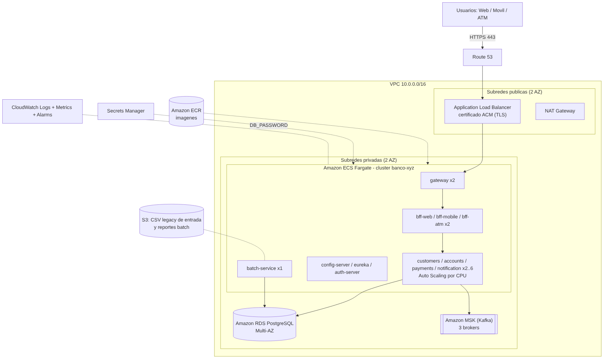

# Despliegue del sistema en la nube (AWS)

Se documentan dos alternativas. La **Opción A** (EC2 + Docker Compose) es la más simple y reproduce exactamente el
entorno local: es la recomendada para la evaluación. La **Opción B** (ECS Fargate + RDS + MSK) es la arquitectura
objetivo de producción, con servicios administrados, alta disponibilidad y escalado automático.



## Preparación del sistema para la nube (ya implementada)

| Característica | Dónde |
|---|---|
| Imágenes Docker multi-etapa, livianas (JRE Alpine) y con usuario **no-root** | `*/Dockerfile` |
| Toda la configuración externa por **variables de entorno** (`DB_HOST`, `KAFKA_BOOTSTRAP_SERVERS`, `EUREKA_URL`, `CONFIG_SERVER_URL`, `JWK_SET_URI`…) | `config-repo/*.yml` con `${VAR:default}` |
| *Health checks* y *probes* `liveness`/`readiness` | Actuator (`/actuator/health/**`) |
| Servicios **sin estado** e id de instancia único en Eureka → escalado horizontal | `config-repo/application.yml` |
| Apagado ordenado (`server.shutdown=graceful`) para despliegues sin cortes | `config-repo/application.yml` |
| Métricas Prometheus, trazas (Zipkin/X-Ray) y logs a stdout (CloudWatch) | Micrometer + `awslogs` |
| TLS en el borde (certificado propio o ACM) | `gateway` perfil `ssl` / ALB |
| Secretos fuera del código | `.env` (local) / AWS Secrets Manager (nube) |

## Herramientas necesarias

* Cuenta de AWS (sirve AWS Academy *Learner Lab*) y **AWS CLI v2** configurado: `aws configure`
* Docker con Buildx (para construir y publicar imágenes)
* Git

---

## Opción A – Amazon EC2 + Docker Compose (recomendada para la evaluación)

### A.1 Red y seguridad

1. **VPC**: usar la VPC por defecto o crear una con una subred pública.
2. **Security Group** `sg-banco-xyz` (reglas de entrada):

| Puerto | Origen | Uso |
|---|---|---|
| 22 | Tu IP (`x.x.x.x/32`) | SSH de administración |
| 8443 | `0.0.0.0/0` | **Gateway HTTPS** (único punto de entrada de los canales) |
| 8761, 3000, 9090 | Tu IP | Eureka, Grafana y Prometheus (solo administración) |

   Los microservicios **no exponen puertos** en el host; Postgres y Kafka quedan dentro de la red Docker.

3. **Par de llaves** (`banco-xyz.pem`) para SSH.

### A.2 Lanzar la instancia

* AMI: **Amazon Linux 2023**
* Tipo: **t3.xlarge** (4 vCPU, 16 GB) — mínimo `t3.large` (8 GB) sin el perfil de monitoreo
* Disco: 30 GB gp3
* Security Group: `sg-banco-xyz`
* *Advanced details → User data*: pegar el contenido de [`deploy/aws/ec2-user-data.sh`](deploy/aws/ec2-user-data.sh)
  (instala Docker y Compose, clona el repositorio y ejecuta `docker compose up --build -d`).
* (Opcional) *IAM instance profile* con permiso `secretsmanager:GetSecretValue` para leer los secretos.

Consola: *EC2 → Launch instance*. Con la CLI:

```bash
aws ec2 run-instances --image-id resolve:ssm:/aws/service/ami-amazon-linux-latest/al2023-ami-kernel-default-x86_64 \
  --instance-type t3.xlarge --key-name banco-xyz --security-group-ids <sg-id> \
  --block-device-mappings 'DeviceName=/dev/xvda,Ebs={VolumeSize=30,VolumeType=gp3}' \
  --user-data file://deploy/aws/ec2-user-data.sh \
  --tag-specifications 'ResourceType=instance,Tags=[{Key=Name,Value=banco-xyz}]'
```

### A.3 Secretos (recomendado)

```bash
aws secretsmanager create-secret --name banco-xyz/prod --secret-string \
  '{"DB_USER":"bank","DB_PASSWORD":"<clave-segura>","SSL_KEYSTORE_PASSWORD":"<clave>","GRAFANA_PASSWORD":"<clave>"}'
```

El *user data* genera el archivo `.env` desde este secreto. Si no existe, usa `.env.example`.

### A.4 Verificar

```bash
ssh -i banco-xyz.pem ec2-user@<IP-PUBLICA>
cd /opt/banco-xyz
sudo docker compose ps                         # todos (healthy) tras 5-10 min
sudo tail -f /var/log/cloud-init-output.log    # progreso de la instalación
```

Desde tu equipo:

```bash
GW=https://<IP-PUBLICA>:8443 ./scripts/demo.sh
```

### A.5 Operación

| Acción | Comando (en la instancia) |
|---|---|
| Actualizar a la última versión | `git pull && sudo docker compose up --build -d` |
| Escalar un servicio | `sudo docker compose up -d --scale payments-service=3` |
| Activar monitoreo | `sudo TRACING_PROBABILITY=1.0 docker compose --profile monitoring up -d` |
| Ver logs | `sudo docker compose logs -f gateway` |
| Respaldo de la BD | `sudo docker compose exec postgres pg_dumpall -U bank > respaldo.sql` |
| Detener (ahorrar costo) | `sudo docker compose down` y detener la instancia en la consola |

### A.6 HTTPS con dominio propio (opcional)

Para no usar el certificado autofirmado: crear un **Application Load Balancer** con un certificado gratuito de
**AWS Certificate Manager** (listener 443) que reenvíe al puerto 8443 de la instancia (*target group* HTTPS,
*health check* `HTTPS /actuator/health` o puerto 9080), y un registro en **Route 53** apuntando al ALB.

---

## Opción B – Producción: ECS Fargate + RDS + MSK

### B.1 Servicios AWS utilizados

| Necesidad | Servicio AWS | Reemplaza a |
|---|---|---|
| Ejecución de contenedores sin servidores | **Amazon ECS Fargate** (1 servicio ECS por microservicio) | Docker Compose |
| Registro de imágenes | **Amazon ECR** (escaneo de vulnerabilidades al subir) | build local |
| Base de datos relacional | **Amazon RDS for PostgreSQL** Multi-AZ (4 bases) | contenedor `postgres` |
| Mensajería | **Amazon MSK** (Kafka administrado, 3 brokers en 3 AZ) | contenedor `kafka` |
| Entrada HTTPS y balanceo | **Application Load Balancer** + **ACM** + **Route 53** | puerto 8443 del gateway |
| Descubrimiento interno | **AWS Cloud Map** (`*.banco.local`) para config/eureka/auth; Eureka sigue para el balanceo cliente | red Docker |
| Secretos | **AWS Secrets Manager** (inyectados como `secrets` en la tarea ECS) | `.env` |
| Logs, métricas y alarmas | **Amazon CloudWatch** (Logs, Container Insights, Alarms) + Amazon Managed Prometheus/Grafana opcional | Prometheus/Grafana locales |
| Archivos batch | **Amazon S3** (CSV de entrada y reportes; montar con Mountpoint for S3 o copiar al iniciar) | volumen `batch-output` |
| Batch programado | Servicio ECS del `batch-service` con `BATCH_SCHEDULING_ENABLED=true` (o **EventBridge Scheduler** que llama a `POST /api/batch/jobs/...`) | cron del mainframe |

### B.2 Pasos

1. **Red**: VPC con 2 subredes públicas (ALB, NAT) y 2 privadas (ECS, RDS, MSK) en 2 zonas de disponibilidad.
2. **RDS**: PostgreSQL 16, Multi-AZ, subredes privadas. Crear las bases:
   ```sql
   CREATE DATABASE accounts_db; CREATE DATABASE payments_db; CREATE DATABASE customers_db; CREATE DATABASE batch_db;
   ```
3. **MSK**: clúster de 3 brokers (`kafka.t3.small`), anotar los *bootstrap brokers*. Los tópicos se crean al iniciar
   los servicios (3 particiones; en producción usar `replicas(3)`).
4. **Secretos**: `aws secretsmanager create-secret --name banco-xyz/prod ...` (usuario y clave de RDS).
5. **Imágenes**: publicar las 12 imágenes en ECR:
   ```bash
   AWS_REGION=us-east-1 ./deploy/aws/ecr-push.sh v1.0.0
   ```
6. **Clúster ECS** `banco-xyz` (Fargate) con *Container Insights* y un *namespace* de Cloud Map `banco.local`.
7. **Definiciones de tarea**: una por servicio, tomando como modelo
   [`deploy/aws/ecs-task-payments.json`](deploy/aws/ecs-task-payments.json) (imagen ECR, variables de entorno,
   secretos, *health check*, logs `awslogs`). Registrar con:
   ```bash
   aws ecs register-task-definition --cli-input-json file://deploy/aws/ecs-task-payments.json
   ```
8. **Servicios ECS** en este orden: `config-server` → `eureka-server` → `auth-server` → `customers`, `accounts`,
   `payments`, `notification`, `batch` → `bff-web`, `bff-mobile`, `bff-atm` → `gateway`.
   Mínimo **2 tareas** por servicio de negocio/BFF/gateway (alta disponibilidad), 1 para `batch-service`.
9. **ALB**: listener 443 con certificado ACM → *target group* del `gateway` (el gateway sin perfil `ssl`, puerto 8080,
   porque el TLS termina en el ALB; *health check* `/actuator/health`). Redirección 80 → 443.
10. **Escalado automático** (ejemplo para pagos, entre 2 y 6 tareas con CPU objetivo 60 %):
    ```bash
    ./deploy/aws/ecs-autoscaling-payments.sh
    ```
11. **Alarmas CloudWatch**: CPU > 80 %, `HTTPCode_Target_5XX_Count`, tareas en ejecución < mínimo, y una alarma sobre
    el log `FALLO por calidad de datos` / `agotaron los reinicios` del batch.

### B.3 Alternativa intermedia: misma Compose con servicios administrados

Con una instancia EC2 y RDS + MSK administrados (sin compilar en el servidor):

```bash
export REGISTRY=<cuenta>.dkr.ecr.us-east-1.amazonaws.com TAG=v1.0.0
export DB_HOST=<endpoint-rds> DB_USER=bank DB_PASSWORD=<clave> KAFKA_BOOTSTRAP_SERVERS=<brokers-msk>
aws ecr get-login-password | docker login --username AWS --password-stdin $REGISTRY
docker compose -f docker-compose.yaml -f deploy/aws/docker-compose.aws.yml pull
docker compose -f docker-compose.yaml -f deploy/aws/docker-compose.aws.yml up -d --no-build \
  config-server eureka-server auth-server customers-service accounts-service payments-service \
  notification-service batch-service bff-web bff-mobile bff-atm gateway
```

[`deploy/aws/docker-compose.aws.yml`](deploy/aws/docker-compose.aws.yml) cambia las imágenes por las de ECR,
apunta a RDS/MSK y envía los logs a CloudWatch.

---

## Integración y entrega continua

[`.github/workflows/ci.yml`](.github/workflows/ci.yml) compila y ejecuta las pruebas (incluida la equivalencia del
batch con el legacy) en cada *push*. Para entrega continua se agrega un *job* que, en la rama `main`, ejecute
`deploy/aws/ecr-push.sh` (con credenciales OIDC de GitHub → IAM) y `aws ecs update-service --force-new-deployment`
para cada servicio (despliegue *rolling* sin cortes gracias al apagado ordenado y los *health checks*).

## Costos aproximados (us-east-1, referencia)

| Opción | Recursos | Costo aproximado |
|---|---|---|
| A | 1 × t3.xlarge encendida 8 h/día | ~ USD 1,3 por día |
| B | ECS Fargate (≈ 20 tareas 0,5 vCPU/1 GB) + RDS db.t3.medium Multi-AZ + MSK 3 × kafka.t3.small + ALB | ~ USD 900–1.100 por mes |

Recomendación: apagar la instancia de la Opción A cuando no se use; en la Opción B, escalar a 0 los entornos que no
sean de producción.

## Checklist de seguridad en la nube

- [ ] Solo el ALB/Gateway es público; servicios, RDS y MSK en subredes privadas
- [ ] TLS en el borde (ACM) y, en producción, TLS también hacia RDS (`sslmode=require`) y MSK (TLS/IAM)
- [ ] Secretos en Secrets Manager con rotación; ningún secreto en el repositorio
- [ ] Llaves RSA del `auth-server` persistidas en AWS KMS / Secrets Manager (hoy se generan al iniciar)
- [ ] Clientes OAuth2 y usuarios en base de datos (hoy en memoria, solo académico)
- [ ] Escaneo de imágenes ECR activo y roles IAM de mínimo privilegio por tarea
- [ ] AWS WAF delante del ALB (limitación de tasa, reglas OWASP)
